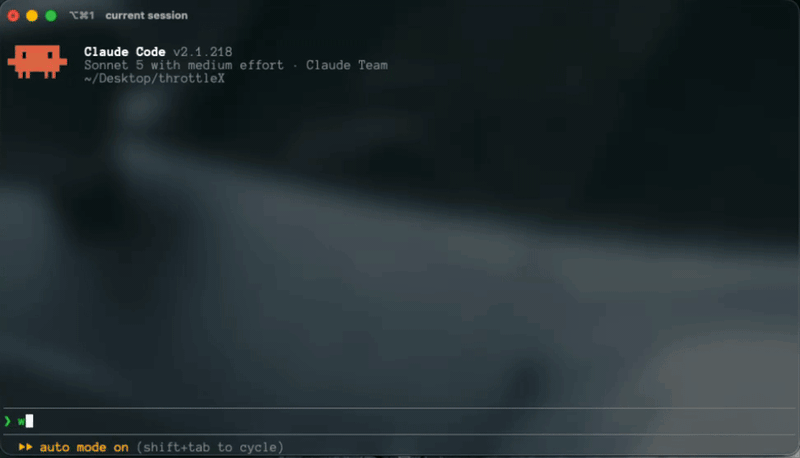

# ContextOS

[](https://www.npmjs.com/package/@siddharthakatiyar/contextos)
[](https://opensource.org/licenses/MIT)
AI coding assistants waste thousands of tokens searching large codebases, often missing the files that actually matter.

ContextOS indexes your repository into a semantic graph so AI Agents retrieve only the relevant functions, classes, documentation, and dependencies—reducing token usage while improving accuracy.

Instead of sending entire files, ContextOS sends only the code the model actually needs.

## Why ContextOS?

Instead of relying on ripgrep and whole-file context, ContextOS understands your repository at the semantic level.

- ✓ **Function-level retrieval** (AST symbols + large template-literal consts)
- ✓ **Sub-chunked large symbols** — oversized functions keep a parent chunk plus additive line-ranged segments (comment-derived segment titles)
- ✓ **Refactor-for-retrieval** — large scorers/compilers split into named helpers so deep markers stay intact
- ✓ **Hybrid search** — FTS5 + symbol/filename boosts + RRF fusion (optional local embeddings)
- ✓ **Automatic dependency expansion** via the relationship graph
- ✓ **Precision-first compile** — top-K full bodies + path:line stubs under a token budget
- ✓ **Cheap expand path** — stubs carry line ranges; `ctx_read_file` supports ranged reads; `ctx_symbol` for one symbol
- ✓ **Cross-session memory**
- ✓ **Incremental indexing** with stable chunk IDs and line ranges
- ✓ **Local-first (SQLite + FTS5 + optional sqlite-vec)**
- ✓ **Confidence-gated embeddings** — emb kNN only when keyword confidence is low (or when explicitly enabled)
- ✓ **Works with any AI Agent via MCP**

## Quick Start

```bash
npm install -g @siddharthakatiyar/contextos

cd my-project

# Registers the project, indexes its checked-out worktrees, and configures supported clients
contextos init
```

A global npm install adds ContextOS instructions to detected supported coding agents by default. Each project still needs `contextos init`. The global guidance asks an agent to check setup and ask you before initializing a new project, including in automatic mode. Local npm installs do not change global instructions. Set `CONTEXTOS_GLOBAL_INSTRUCTIONS=0` during installation to opt out; use `contextos enable` to refresh instructions after installing another agent.

Supported global instruction files cover Codex, Claude Code, Grok Build, OpenCode, Gemini CLI, Antigravity (`agy`), Amp, GitHub Copilot CLI and Windsurf. Cursor requires adding User Rules in its settings; `contextos enable --agent cursor` prints the block to copy. Existing user text is preserved. Global setup does not change client permissions or register projects.

For an agent-friendly setup check, run `contextos setup --check --json`. It reads registration, instructions, indexing readiness and MCP configuration without initializing the project. `contextos init --json` returns structured project/view details after setup. Restart the agent or reconnect MCP to load newly installed configuration.

On Linux x64, `onnxruntime-node` may try to fetch its optional CUDA provider
files during installation. ContextOS works with the bundled CPU runtime, so a
CPU-only installation can skip that optional download:

```bash
ONNXRUNTIME_NODE_INSTALL=skip npm install -g @siddharthakatiyar/contextos
```

This setting only affects the install-time CUDA provider download; it does not
download or disable the local embedding model. Omit it when CUDA execution is
required.

> **Note:** You do **not** need to run `contextos serve` manually. 
> The `serve` command is designed to be called by MCP clients (like any AI Agent) in the background over `stdio`. If you run it manually in your terminal, it will appear to hang as it waits for JSON-RPC messages.

Open your preferred AI Agent and start asking questions! That's it.

After upgrading, restart your MCP client. The daemon automatically schedules a
background rebuild when the indexer format changes; use `contextos reindex` only
when you explicitly want to rebuild the active project's index. Reindexing keeps
memories and history.

## Groups, projects, and worktrees (1.1.1 candidate)

Use a group to search related local projects together. A project can belong to several groups, and ContextOS automatically discovers the Git worktrees that are already checked out on this machine.

```bash
contextos group create payments

cd ~/projects/backend
contextos init --group payments

contextos group add payments ~/projects/frontend
contextos group add payments ~/projects/shared-types
contextos group show payments
contextos worktree list --project backend

contextos query "Where is payment status defined, processed, and displayed?" --group payments
```

`contextos init` registers the current project and indexes its available worktrees. `group add` does the same for a new project, or adds an existing project to another group. Repeating either command reuses the existing project identity and index. `contextos repo` remains an alias for `contextos project` for existing scripts.

By default, a query searches the current checkout. `--group payments` searches one live checkout per project; add `--all-worktrees` to include every available checkout in the selected group. Use `--project backend --worktree <path-or-id>` to select a particular checkout. Results carry project, branch, worktree, and source-file details.

One MCP server can use a group while keeping a chosen project active by default:

```bash
contextos serve --group payments --project backend
```

The agent can request a group or a particular project/worktree for an individual retrieval. ContextOS keeps each connection's default scope separate.

### Agent-maintained knowledge

ContextOS indexes source files and also stores durable facts and verified links between projects and worktrees. Agents can use `ctx_scope`, `ctx_links`, `ctx_link`, `ctx_remember`, `ctx_unlink`, and `ctx_forget` to inspect or maintain that knowledge. A link is saved with supporting evidence only when the agent has established the connection; uncertain or ambiguous matches remain unsaved. Branch-specific knowledge stays with its worktree view, and retrieval follows links only within the selected scope.

Use `ctx_trace` to follow recorded relationships across a group. It returns ordered shortest witness paths, project/branch citations, edge direction and source evidence. Select `outgoing`, `incoming` or `both`; reverse steps are explicitly labeled. Missing connections, stale or unavailable evidence, and depth/node/edge/path limits are reported. A trace describes the recorded graph; it does not claim that every dependency has been discovered.

Discovery grows during normal agent work. `ctx_resolve_import` inspects one exact JavaScript/TypeScript local import or Go module replacement, returning indexed export locations and manifest evidence. `ctx_contract` inspects indexed OpenAPI JSON/YAML or protobuf operations, including HTTP methods, paths, schema definitions and gRPC streaming signatures. Neither tool saves relationships or runs a discovery pass. Agents inspect the binding, routing or call-site evidence and use `ctx_link` once a connection is established.

Combined retrieval examines a bounded set of retrieved files for literal local JS/TS imports. When fresh source, target and explicit dependency mappings establish an exact file dependency, it saves a link marked with deterministic provenance and returns it in `learnedLinks`. Repeated queries preserve existing agent-authored links. Unresolved local imports appear in `linkSuggestions` without a guessed target and are never stored. Other connections still need agent verification: for a configuration-to-Postgres relationship, inspect the mapping, entrypoint and consumer together before saving the link. Similar names alone are insufficient.

Import inspection currently supports relative JS/TS imports, explicit `file:`/`link:` package dependencies, exact package export subpaths/conditions, and local Go `replace` directives. Registry dependencies, unresolved `workspace:*` references, wildcard exports, re-exports and source-map guesses require agent inspection. Locating an exported symbol does not by itself prove that the source consumes it. Contract inspection retains external `$ref` values without fetching them; OpenAPI citations cover the complete source contract, while protobuf RPCs retain their source line ranges.

Example MCP calls, after obtaining qualified chunk references from `get_context` or `ctx_symbol`:

```json
{"name":"ctx_trace","arguments":{"group":"payments","start":"<frontend chunk ref>","target":"<worker chunk ref>","direction":"both","max_depth":6}}
```

```json
{"name":"ctx_resolve_import","arguments":{"group":"payments","source":"<importing chunk ref>","specifier":"@payments/shared-types","symbol":"PaymentStatus","mode":"types"}}
```

```json
{"name":"ctx_contract","arguments":{"group":"payments","ref":"<contract chunk ref>","operation":"POST /checkout","include_schemas":true}}
```

### Global storage

New ContextOS data lives under `~/.contextos/`, not in a new `.contextos` folder in every project:

```text
~/.contextos/
  registry.db
  graph.db
  config.json
  projects/<project-id>/
    config.json
    views/<view-id>/index.db
  runtime/
```

The registry tracks groups, projects, worktrees, and branch views. Each view has its own index; the graph stores verified cross-project knowledge. This keeps branch contents and local IDs isolated while allowing group retrieval. Existing `.contextos` data is read during migration and left in place; the new index is written globally.

Removing a project from a group keeps its indexes and knowledge. `contextos clean --dry-run` previews views left behind by removed worktrees or deleted branches. `contextos project remove <project> --purge` explicitly deletes the project's stored indexes and knowledge while leaving source files untouched.

**Release status:** the 1.1.1 redesign is a local testing candidate. It is not available from npm; test it from a source checkout as described in [the testing guide](MULTI_REPOSITORY_TESTING.md). Do not publish a release until local testing is complete and the user has approved it.

## The Problem: Traditional vs. ContextOS

### ⚡️ The ContextOS Difference

| Without ContextOS (42K+ Tokens) | With ContextOS (293 Tokens) |
|:---:|:---:|
|  |  |
| *Spawns expensive Explore subagents, blindly greps files, massive context bloat.* | *Instant semantic retrieval, pinpoint accuracy, minimal context usage.* |

| Traditional (Grep + Read) | ContextOS |
|---|---|
| Line hits, then whole-file Reads | Semantic symbols in one call |
| ripgrep | FTS5 + RRF + graph + filename/symbol boosts |
| Stateless | Learns over time |
| Manual context | Automatic retrieval |
| Often 2+ tool calls | Typically one `get_context` call |

### 100-Query Retrieval Benchmark (Redis 7.x Codebase)

A 100-query benchmark (50 targeted function queries, 50 broad conceptual queries) on a Redis 7.x C checkout. "Accuracy" here is file-level recall among retrieved candidates. The figures below are a recorded run, not a release guarantee; reproduce it with the benchmark instructions in [`scripts/bench/`](scripts/bench/) and record the checkout and commit used.

| Metric | ContextOS |
|--------|-----------|
| **Targeted file recall** (exact-function queries) | **98%** (49/50) |
| **Conceptual file recall** (broad queries) | **96%** (48/50) |
| **Overall file recall** | **97%** (97/100) |
| **Avg tokens / query** | **589** |
| **Total tokens** (100 queries) | **58,880** |

This is a recorded Redis checkout run. Reproduce the 100-query harness after
building the CLI by supplying your own checkout; the harness keeps its SQLite
state and report outside that checkout:

```bash
npm run build
CONTEXTOS_EMBEDDINGS=0 CONTEXTOS_REDIS_REPO=/path/to/redis \
  node scripts/bench/run-redis-bench.mjs --output-dir "$TMPDIR/contextos-redis-results"
```

The Redis report writes `redis-results.json` and records aggregate
`expectedFileRecallPercent` (all expected files found divided by all expected
files), `anyHitRatePercent` (queries with at least one expected file), and
targeted/generic token averages. These are file-level retrieval metrics for the
specified checkout and query corpus, not model quality guarantees.


**Key Takeaways:**
- **Surgical Precision:** ContextOS achieves 97% file-level accuracy while using **up to 99% fewer tokens** than traditional multi-file keyword chunking.
- **Near-Flawless Targeted Retrieval:** ContextOS's AST-aware matcher reliably zeroes in on exact function implementations (98% hit rate).
- **Strong Conceptual Retrieval:** ContextOS successfully resolves broad queries (e.g. "How does Redis start up?") to core implementation files 96% of the time, avoiding noise from dependencies or test scripts.

### Real-World Repository Benchmark (recorded run)

A 25-query end-to-end benchmark measuring an agent's retrieval workflow across five open-source repositories (five queries each). The result is corpus-, prompt-, and model-specific; it is included as a reproducible reference rather than a promise of perfect accuracy.

| Repository | Agent Resolution Accuracy | Avg Tokens / Query |
|------------|---------------------------|--------------------|
| **Next.js** | 100% (5/5) | ~132 |
| **React** | 100% (5/5) | ~470 |
| **Langchain**| 100% (5/5) | ~194 |
| **FastAPI** | 100% (5/5) | ~262 |
| **Supabase** | 100% (5/5) | ~333 |
| **Overall** | 100% (25/25) | **~278** |

**Key Takeaways:**
- The recorded run resolved the listed queries with the corpus and evaluation procedure used at that time.
- Results will vary with repository revisions, query sets, model behavior, and configuration; use the scripts and checked-in fixtures to compare runs.

For the smaller checked-in fixture harness, `npm run bench -- --json` indexes
temporary copies of `retrieval-examples/` and emits JSON with
`passRatePercent`, `averageRecallPercent`, `expectedFileRecallPercent`, and
`anyHitRatePercent`. It does not require a Redis checkout. Set
`CONTEXTOS_EMBEDDINGS=0` for deterministic keyword-only fixture comparisons.

## Real Retrieval Example

**User asks:**
> "How does authentication work?"

**Retrieved Context:**
- ✓ `login()` function (from `src/auth.ts`) — full body
- ✓ Related symbols as one-line stubs (path + signature) when budget is tight
- ✓ Graph-linked helpers / types when relevant

**Total tokens:** typically under the default **1,200** budget *(instead of multi-file Reads totaling thousands)*

The MCP `get_context` tool defaults to `tier: "stub"`, which returns compact
signatures and locations. Use `tier: "full"` when you need implementation
bodies. `output_format` accepts `"markdown"` (the default) or `"xml"`; both
formats are budgeted and returned by the tool.

## Architecture

```text
          Repository
        (src/, docs/, config/)
                  │
                  ▼
         Tree-sitter Parsers
          Markdown Parsers
                  │
                  ▼
         Semantic Graph Engine
           (SQLite + FTS5 + porter)
           + line ranges / file_stem
           + optional MiniLM embeddings
                  │
                  ▼
 ┌─────────────────────────────────┐
 │ Intent + keyword / stem / symbol│
 │ RRF fusion (+ optional emb kNN) │
 │ Graph expansion                 │
 │ Scoring + containment dedup     │
 │ Query-aware tiered compile      │
 │ Cross-session memory            │
 └─────────────────────────────────┘
                  │
                  ▼
         MCP Server (Stdio)
                  │
                   ▼
        AI Agent (via MCP)
```

## Features

### Indexing

**AST-aware chunks**  
Tree-sitter extracts functions, classes, and methods. Nested methods record `parent_symbol` so class vs method duplication can be deduped at retrieval time. Large top-level template-literal / string constants (e.g. SQL DDL) are indexed as searchable variables. Trivial anonymous lambdas are skipped. Chunks store stable IDs, `start_line` / `end_line`, and `file_stem` for ranking.

**Compact class outlines**  
When a class has methods, the class chunk stores a short member list instead of repeating every method body.

**Local embeddings (index-time)**  
On upsert, chunks are embedded with a local MiniLM model (`@huggingface/transformers`) into `sqlite-vec` when available. Indexing is on by default; **retrieval fusion is off by default** (keyword/RRF path is the accuracy baseline). Opt in with `embeddingsRetrieval: true` or `CONTEXTOS_EMBEDDINGS_RETRIEVAL=1`.

### Retrieval

**Multi-strategy matching + RRF**  
FTS5 (porter tokenizer, operator-preserving sanitizer), exact/prefix symbol lookup, filename and path-stem boosts, and intent-aware queries are fused with Reciprocal Rank Fusion. Group retrieval ranks evidence within each selected view before combining results, and gives a modest preference to the active checkout.

**Graph expansion**  
Seeds from identifiers and top hits expand through the relationship graph (depth/node caps are configurable), including import edges.

**Containment dedup**  
If both a class outline and its methods survive ranking, oversized class bodies yield to methods; scores are merged.

### Context assembly (compile)

**Tiered, precision-first output**  
- Top-K chunks (adaptive, usually up to 3) render as **full bodies**
- Remaining hits become **stubs with path + line ranges** (`symbol — path/file.ts:12-84`) so agents can `ctx_read_file` or `ctx_symbol` instead of whole-file Reads
- Query-aware truncation preserves high-signal lines, comments/JSDoc, and branch headers
- Related entities capped; File Structure capped to one chunk
- Framing (headers / fences) counts toward the token budget (`gpt-tokenizer`)

**Diagnostic header**  
`get_context` prefixes a single line: `ContextOS | tokens: N/M`. When stubs remain, a one-line footer steers agents to `ctx_symbol` / ranged `ctx_read_file`.

### Memory

**Adaptive learning**  
Agents can rate chunks; feedback adjusts future scores (including implicit signals).

**Cross-session memory**  
Verified facts saved with `ctx_remember` persist across sessions and can appear in `get_context`. Code facts require current source evidence; explicit user decisions use user provenance. View facts stay branch/worktree-specific, while project/group user decisions apply across branches.

**Backup & Recovery**  
Source-derived indexes can be rebuilt, but `~/.contextos/` also holds memories, verified links, feedback, and session history. Stop the ContextOS daemon before backing up this directory, and copy SQLite databases together with any `-wal` and `-shm` sidecars. Existing repository `.contextos` files are migration sources; new index writes go to global per-view databases. Use `contextos clean --dry-run` before removing obsolete worktree views.

### Developer Experience

**CLI**  
`init`, `setup`, `enable`, `reindex`, `serve`, `query`, `status`, `doctor`, `watch`, `visualize`, and more.
*Commands support graceful cancellation (Ctrl+C / SIGINT) to safely abort long-running indexing operations and rollback in-flight database transactions without causing lock-ups.*

**Diagnostics**

`contextos doctor` checks local MCP configuration, index health and freshness,
and daemon state without changing files. It reports each result as `pass`,
`warn`, `fail`, or `unknown`; missing state or telemetry is `unknown`, and the
command exits with code 1 only when a check confirms a failure. Use
`contextos doctor --json` for a machine-readable report. Add `--explain` to
`contextos query` to inspect the ranking signals recorded for retrieved chunks
and the compiler's tier, token budgets, and included or omitted chunks.
`contextos doctor --client codex --noninteractive` also inventories instruction
files/imports, MCP registrations and local per-tool permissions. Instruction
discovery and tool approval are separate checks: loading `AGENTS.md` cannot
override a client that denies a call or requires an unanswered approval prompt.
Doctor reports the registered project, branch/worktree and index readiness;
effective session loading and runtime/organization policy remain unknown when
they cannot be observed. Diagnostic reports never change permissions.

**Updates**

Normal CLI commands and each MCP `serve` session check npm for updates. Help,
version, doctor, and internal daemon startup skip the notice; upgrade fetches
the release list directly. The bounded check reports available updates on
stderr; registry failures stay quiet and are reported as `unknown` by the
`contextos_update_status` MCP tool. Update notices never write
to the MCP stdio or JSON result stream. `contextos upgrade` explicitly stages
and verifies the latest compatible release, drains the daemon, then installs
and verifies it. Use `contextos upgrade --version X.Y.Z` to select a version;
`--allow-major` is required for a major-version change. Self-upgrade is limited
to global npm installs on Linux and refuses when it cannot prove the package is
safe to replace; close active ContextOS clients before upgrading. Source
checkouts, local installs, and `npx` runs are not modified; upgrade those with
Git or by running `npm install -g @siddharthakatiyar/contextos@X.Y.Z` as
appropriate. `contextos upgrade --dry-run` resolves a compatible published
version and prints a read-only manual plan for recognized global npm, local
npm/pnpm/Yarn, or source-checkout installs. Unknown, linked, and workspace
layouts require their native update workflow. Automatic patch updates are on
by default before an MCP `serve` session connects, but only for supported Linux
global npm installs. The npm install includes a short notice, and the first
substantive CLI invocation repeats a one-time reminder in case npm suppressed
the lifecycle output. Run `contextos updates policy notify` to disable
automatic patch updates; run `contextos updates policy auto-patch` to enable
them again. A saved per-user preference such as `notify` is preserved. If no
preference exists, the default is `auto-patch`. Explicit choices are stored
for your user in `~/.contextos/update-policy.json` and are not read from
project configuration; an invalid or unsafe preference fails closed to
`notify`.
Auto-patching applies only to stable releases with a higher
patch number in the same major and minor version, and only for supported Linux
global npm installs. Before replacing files, it skips when registry access is
unavailable, another ContextOS process is active, or the staged package cannot
be verified; the existing CLI keeps serving. A verified replacement restarts
the MCP `serve` process with the updated CLI. If rollback cannot verify the
previous install, or the new process cannot start, serving stops with recovery
instructions instead of running code from an uncertain or replaced package.
Resolve the issue and run `contextos serve` again. Notices and skip reasons go
to stderr.

**Concurrency**  
Project and worktree indexing is coordinated through one shared user daemon with bounded scan concurrency. Different views keep their indexes isolated while avoiding a separate long-lived indexing service per repository.

**MCP tools**  
The default tools include `get_context`, `ctx_scope`, `ctx_link`, `ctx_links`, `ctx_trace`, `ctx_resolve_import`, `ctx_contract`, `ctx_unlink`, `ctx_remember`, `ctx_forget`, `reindex_context`, `contextos_status`, `ctx_execute`, `ctx_read_file`, `ctx_expand`, `ctx_topics`, and `ctx_symbol`. Knowledge writes require current evidence references and view generations. Deprecated compatibility tools: enabling `legacyTools` adds `get_symbol`, `get_neighbors`, `save_context`, `ctx_list_topics`, `ctx_read_topic`, `rate_chunk`, `learn_fact`, and `forget_fact` alongside the default tools. These aliases retain the selected project/worktree scope. `learn_fact` follows the same evidence and provenance requirements as `ctx_remember`; an old call with an unsupported claim is rejected rather than silently saved.

**Zero-config setup**  
`contextos init` registers and indexes the active project and its checked-out worktrees, installs shared agent guidance in `AGENTS.md`, and adds `@AGENTS.md` to `CLAUDE.md` for Claude Code compatibility if it is missing. Existing user guidance is preserved; older generated ContextOS sections move from `CLAUDE.md` to `AGENTS.md`. Initialization also updates supported MCP configuration while preserving existing entries. Use `--no-index` to register without starting a scan. `group add` indexes and groups another project without changing its agent configuration.

## Configuration

Defaults live in `src/config/defaults.ts` and can be overridden via:

- `~/.contextos/config.json` (global)
- `~/.contextos/projects/<project-id>/config.json` (project)
- `.contextos/config.json` (read only as a legacy configuration during migration)
- Env: `CONTEXTOS_EMBEDDINGS=0` disables embedding; `CONTEXTOS_EMBEDDINGS_RETRIEVAL=1` enables emb fusion at query time

Array keys in config use a `!` **suffix** to override (replace rather than merge) where documented — e.g. `"ignorePatterns!": ["only/**"]`.

| Key | Default | Notes |
|-----|---------|--------|
| `maxTokenBudget` | `1200` | Default compile budget; `get_context` `max_tokens` still accepts up to `8000` |
| `maxRetrievalResults` | `25` | Cap on scored chunks before compile |
| `ftsLimit` | `15` | Per-query FTS hit limit |
| `maxChunkTokens` | `1500` | Soft cap when creating chunks |
| `maxSymbolChunkTokens` | `900` | Function/method bodies above this also emit additive segment chunks |
| `layerBoosts` | session 1.5 / repo 1.3 / workspace 1.1 / global 1.0 | Multiplicative score boosts |
| `graphExpansionDepth` | `2` | Relationship walk depth |
| `graphExpansionMaxNodes` | `20` | Cap on expanded entities |
| `diversityDecay` | `0.7` | Penalty for many chunks from one file |
| `diversityPenaltyStart` | `3` | Start applying diversity decay after N chunks/file |
| `embeddingsEnabled` | `true` | Index-time local embeddings (`CONTEXTOS_EMBEDDINGS=0` to disable) |
| `execAllowRepoScripts` | `false` | Permit `ctx_execute` to run repository scripts; enable only for trusted repositories |

### Pipeline Configurations

The optional `pipeline` object in config enables toggling specific query-time pipelines on or off:

| Key | Default | Notes |
|-----|---------|--------|
| `pipeline.graphExpansion` | `true` | Enable/disable relationship walking. |
| `pipeline.embeddingFusion` | *(unset)* | Fuse embedding kNN into retrieval. When unset it follows `embeddingsRetrieval` (off by default; confidence-gated fallback). Set `true`/`false` to force. |
| `pipeline.containmentDedup` | `true` | Enable/disable deduplication between classes and their member methods. |
| `pipeline.diversityFilter` | `true` | Enable/disable score decay for many chunks originating from the same file. |

### `get_context` parameters

| Param | Default | Description |
|-------|---------|-------------|
| `prompt` | required | Task or question |
| `max_tokens` | `maxTokenBudget` (1200) | Compile budget; max 8000 |
| `layers` | `session`, `workspace`, `repo` | Add `global` only when you need shared/third-party context |
| `tier` | `stub` | Use `full` when implementation bodies are required |
| `output_format` | `markdown` | Or `xml` |
| `group` / `project` | active group / active project | Select a group or one or more projects |
| `worktree` / `branch` | active view | Select a checkout or checked-out branch |
| `all_worktrees` | `false` | Include every available worktree in scope |
| `workspace` / `repo` / `all_repos` | compatibility aliases | Existing clients may continue using these selectors |

## CLI cheatsheet

```bash
contextos init                 # Register/index project worktrees and install agent guidance
contextos init --json          # Structured setup result, indexing progress on stderr
contextos setup --check --json # Read-only project onboarding check
contextos enable              # Refresh user-wide instructions for detected agents
contextos enable --dry-run    # Preview instruction-file changes
contextos group create payments
contextos group add payments ~/projects/frontend
contextos group show payments
contextos project list         # `contextos repo` remains an alias
contextos worktree list --project backend
contextos clean --dry-run      # Review removed-worktree and deleted-branch views
contextos project remove backend --purge # Remove stored data, keeping source files
contextos reindex              # Rebuild the selected index; retain memories/history
contextos reindex --embeddings # Backfill vectors without wiping the DB
contextos serve --group payments --project backend # MCP stdio server, run by the client
contextos query "..."          # Test retrieval locally
contextos query "..." --explain # Show retrieval and compilation diagnostics
contextos query "..." --json --explain # Include diagnostics in the JSON output
contextos status --group payments # Project/worktree indexing status
contextos doctor               # Read-only configuration, index, and daemon checks
contextos doctor --json        # Machine-readable diagnostic report
contextos doctor --client codex --noninteractive # Instruction discovery and tool permission observations
contextos upgrade              # Stage and install the latest compatible release (global npm on Linux)
contextos upgrade --version 1.2.3 # Select a release; add --allow-major for major-version changes
contextos upgrade --dry-run    # Print a portable manual upgrade plan without changes
contextos updates policy      # Show the per-user update setting (auto-patch by default)
contextos updates policy notify     # Disable automatic patch updates
contextos updates policy auto-patch # Enable automatic patch updates
contextos watch                # Live re-index on file changes
```

## Supported Languages

ContextOS leverages Tree-sitter for robust parsing. Supported out of the box:
- ✓ TypeScript / JavaScript (incl. TSX/JSX)
- ✓ Go
- ✓ Python
- ✓ Java
- ✓ C / C++
- ✓ C#
- ✓ Rust
- ✓ Ruby
- ✓ Swift
- ✓ Kotlin
- ✓ Markdown
- ✓ Common config formats (JSON, YAML, TOML, …)

## Quantifiable Benefits

- **Token Efficiency:** ~589 tokens/query (58.8k across 100 queries); a one-time comparison measured up to 99% fewer tokens than a multi-file extraction proxy.
- **98% Precision on Exact Functions:** The AST-aware matcher reliably finds implementation bodies instead of grepping test files.
- **Robust Conceptual Retrieval:** Resolves broad queries accurately 96% of the time.
- **Low latency:** Local SQLite FTS5 retrieval typically completes in milliseconds.
- **Cost savings:** Smaller prompts for API-backed agents mean significantly lower spend per query, and fewer API round-trips.

## Author

**Siddhartha Katiyar**

- Twitter/X: [@siddharthakat25](https://x.com/siddharthakat25)
- LinkedIn: [Siddhartha Katiyar](https://www.linkedin.com/in/siddharthakatiyar/)

## License

MIT — see [LICENSE](LICENSE).
